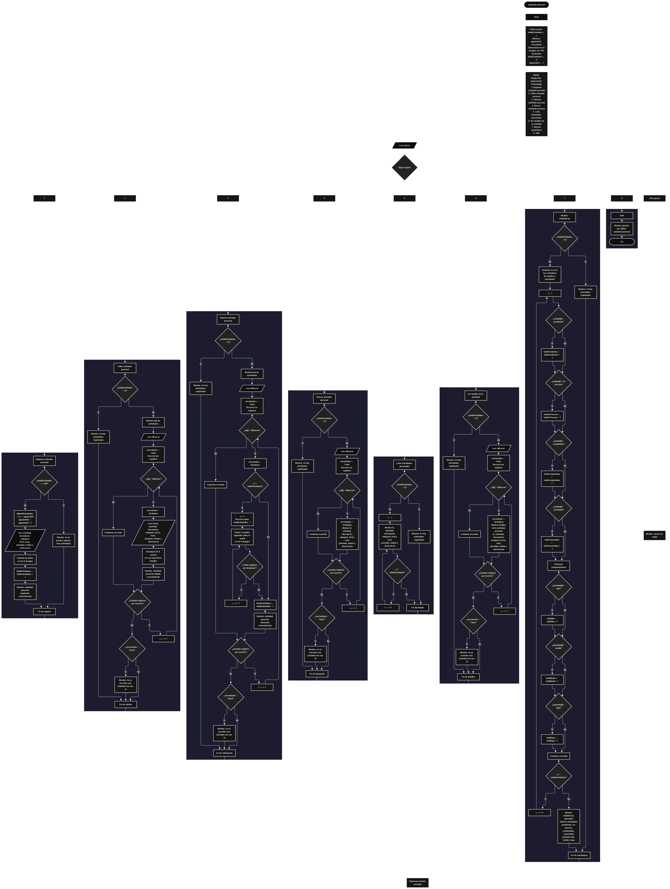

Este proyecto, llamado <b>asistente personal</b>, fue desarrollado en <b>pseint</b> como un ejercicio práctico para fortalecer la lógica de programación mediante la creación de un sistema de gestión de actividades personales desde la consola. El programa cuenta con un menú principal de ocho opciones que permite <b>registrar, editar, eliminar, buscar, listar y consultar los detalles</b> de las actividades registradas, además de mostrar estadísticas generales. Cada actividad almacena datos como el nombre, la descripción, la categoría, la fecha, la hora, la prioridad, el estado y las observaciones, utilizando arreglos con una capacidad máxima de <b>100 actividades durante la ejecución</b>. Durante su desarrollo se aplicaron conceptos fundamentales de programación, como variables, arreglos, estructuras condicionales, ciclos repetitivos y estructuras de selección, además de procesos para buscar, modificar, eliminar y organizar registros. Este proyecto permite poner en práctica los conocimientos adquiridos en PSeInt y sirve como base para desarrollar sistemas de gestión personal más avanzados utilizando otros lenguajes y tecnologías.

<h2 align="center">⚙️ Funcionamiento del menú principal</h2>

### ➕ Registrar actividad personal

La opción <b>1) registrar actividad personal</b> permite registrar una nueva actividad en el sistema. Antes de realizar el registro, el programa comprueba que la cantidad de actividades almacenadas sea menor que <b>100</b>, utilizando la condición <b>totalactividades &lt; 100</b>. Si existe espacio disponible, asigna un identificador mediante la variable <b>siguienteid</b> y solicita el <b>nombre de la actividad, descripción, categoría, fecha, hora, prioridad, estado y observación</b>. Los datos se almacenan en la posición correspondiente de sus respectivos arreglos. Finalmente, aumenta la variable <b>totalactividades</b> en uno y muestra el mensaje <b>"actividad personal registrada correctamente."</b>. Si se alcanza la capacidad máxima, presenta el mensaje <b>"no se pueden registrar mas actividades."</b>, impidiendo registrar otra actividad.

### ✏️ Editar actividad personal

La opción <b>2) editar actividad personal</b> permite modificar la información de una actividad registrada. Primero, el programa comprueba si existen actividades almacenadas mediante la variable <b>totalactividades</b>. Si no hay registros, muestra el mensaje <b>"no hay actividades registradas."</b>. En caso contrario, presenta una lista con el id, nombre, descripción, categoría, fecha, hora, prioridad, estado y observación de cada actividad. Después, solicita el id de la actividad que se desea editar y utiliza un ciclo <b>para</b> para recorrer los registros y localizar la coincidencia mediante la condición <b>id[i] = idbuscar</b>. Si encuentra la actividad, cambia la variable lógica <b>encontrado</b> a <b>verdadero</b> y solicita el nuevo nombre, descripción, categoría, fecha, hora, prioridad, estado y observación, actualizando directamente los arreglos correspondientes. Finalmente, presenta el mensaje <b>"actividad personal editada correctamente."</b>. Si el identificador introducido no corresponde a una actividad registrada, muestra el mensaje <b>"no se encontro una actividad con ese id."</b>.

### 🗑️ Eliminar actividad personal

La opción <b>3) eliminar actividad personal</b> permite eliminar una actividad registrada mediante su identificador. Antes de comenzar, el programa comprueba que existan actividades almacenadas. Si no hay registros, muestra el mensaje <b>"no hay actividades registradas."</b>. Si existen actividades, presenta una lista con sus datos y solicita el id de la actividad que se desea eliminar. Después, utiliza la variable lógica <b>encontrado</b> para determinar si el identificador existe. Cuando encuentra una coincidencia, comprueba si la actividad se encuentra antes de la última posición mediante la condición <b>i &lt; totalactividades</b>. Si se cumple, utiliza un ciclo <b>para</b> controlado por la variable <b>j</b> para desplazar una posición hacia atrás los datos de los arreglos <b>id, actividad, descripcion, categoria, fecha, hora, prioridad, estado y observacion</b>. Posteriormente, disminuye la variable <b>totalactividades</b> en uno y muestra el mensaje <b>"actividad personal eliminada correctamente."</b>. Si no encuentra el identificador solicitado, presenta el mensaje <b>"no se encontro una actividad con ese id."</b>.

### 🔎 Buscar actividad personal

La opción <b>4) buscar actividad personal</b> permite localizar una actividad mediante su identificador. Primero, el programa comprueba si existen actividades registradas. Si no hay registros, muestra el mensaje <b>"no hay actividades registradas."</b>. En caso contrario, solicita el id de la actividad que se desea buscar e inicializa la variable lógica <b>encontrado</b> con el valor <b>falso</b>. A continuación, utiliza un ciclo <b>para</b> para recorrer los identificadores almacenados y compararlos con el valor introducido mediante la condición <b>id[i] = idbuscar</b>. Cuando encuentra una coincidencia, cambia la variable <b>encontrado</b> a <b>verdadero</b> y muestra el id, nombre, descripción, categoría, fecha, hora, prioridad, estado y observación de la actividad. Si finaliza el recorrido sin encontrar coincidencias, presenta el mensaje <b>"no se encontro una actividad con ese id."</b>.

### 📋 Listar actividades personales

La opción <b>5) listar actividades personales</b> permite visualizar todas las actividades registradas en el sistema. Antes de mostrar la información, el programa comprueba si la variable <b>totalactividades</b> es igual a cero. Si no existen actividades, presenta el mensaje <b>"no hay actividades registradas."</b>. Si hay registros disponibles, muestra el encabezado <b>"datos registrados"</b> y utiliza un ciclo <b>para</b> para recorrer los arreglos desde la primera posición hasta el total de actividades registradas. Durante el recorrido, presenta el id, nombre, descripción, categoría, fecha, hora, prioridad, estado y observación de cada actividad. Esta función facilita consultar los registros almacenados sin necesidad de buscar cada actividad individualmente.

### 📄 Ver detalles de la actividad personal

La opción <b>6) ver detalles de la actividad personal</b> permite consultar toda la información de una actividad específica. Primero, el programa comprueba si existen actividades registradas. Si no hay registros, muestra el mensaje <b>"no hay actividades registradas."</b>. En caso contrario, solicita el id de la actividad que se desea consultar y utiliza un ciclo <b>para</b> para recorrer los identificadores almacenados. Cuando encuentra una coincidencia, cambia la variable lógica <b>encontrado</b> a <b>verdadero</b> y muestra el encabezado <b>"detalles de la actividad personal"</b>, seguido del id, nombre, descripción, categoría, fecha, hora, prioridad, estado y observación. Si el identificador no corresponde a una actividad registrada, presenta el mensaje <b>"no se encontro una actividad con ese id."</b>.

### 📊 Mostrar estadísticas

La opción <b>7) mostrar estadísticas</b> permite conocer la distribución de las actividades registradas según su estado y prioridad. Primero, el programa comprueba si existen actividades almacenadas. Si no hay registros, muestra el mensaje <b>"no hay actividades registradas."</b>. En caso contrario, inicializa los contadores correspondientes a los estados y las prioridades en cero y utiliza un ciclo <b>para</b> para recorrer todas las actividades. Mediante estructuras condicionales, cuenta las actividades con estado <b>pendiente, en proceso, completado y cancelado</b>, así como las actividades con prioridad <b>alta, media y baja</b>. Finalmente, muestra el total de actividades, las cantidades correspondientes a cada estado y la distribución según la prioridad. Los resultados se calculan comparando los valores almacenados en los arreglos <b>estado</b> y <b>prioridad</b> con los textos definidos en el código.

### 🚪 Salir del menú principal

La opción <b>8) salir</b> está destinada a finalizar la ejecución del programa y muestra el mensaje <b>"gracias por utilizar asistente personal."</b>. El menú principal se encuentra dentro de una estructura repetitiva <b>repetir ... hasta que</b>, que mantiene el programa en funcionamiento mientras el usuario selecciona las diferentes operaciones disponibles. En este caso, la condición final es <b>hasta que opcion = 8</b>, que coincide con el número de la opción de salida. Por este motivo, al seleccionar la opción 8, el ciclo termina y finaliza la ejecución del algoritmo.

<h2 align="center">🧠 Temas aplicados en el proyecto</h2>

### 📦 Variables

En este proyecto se utilizan variables para almacenar la opción seleccionada en el menú, controlar la cantidad de actividades registradas, generar identificadores, recorrer los arreglos, seleccionar la actividad que se desea editar, eliminar o consultar y comprobar si se encontró una coincidencia. También se utilizan variables para contar las actividades según su estado y prioridad. Cada variable cumple una función específica dentro de las operaciones de gestión de actividades personales.

🔢 **Opcion:** Almacena la opción seleccionada por el usuario en el menú principal.

📊 **TotalActividades:** Almacena la cantidad actual de actividades registradas.

🔄 **I:** Funciona como contador en los ciclos <b>para</b> y permite acceder a la posición de cada actividad.

🔁 **J:** Controla el recorrido utilizado para desplazar los datos durante la eliminación de una actividad.

🔎 **IdBuscar:** Almacena el identificador introducido por el usuario para localizar una actividad.

🆔 **SiguienteID:** Genera los identificadores consecutivos de las nuevas actividades registradas.

✅ **Encontrado:** Variable lógica que indica si se encontró una actividad con el identificador solicitado.

📊 **TotalPendientes:** Cuenta las actividades cuyo estado es pendiente.

🔄 **TotalEnProceso:** Cuenta las actividades cuyo estado es en proceso.

✅ **TotalCompletadas:** Cuenta las actividades cuyo estado es completado.

❌ **TotalCanceladas:** Cuenta las actividades cuyo estado es cancelado.

🔴 **TotalAlta:** Cuenta las actividades con prioridad alta.

🟡 **TotalMedia:** Cuenta las actividades con prioridad media.

🟢 **TotalBaja:** Cuenta las actividades con prioridad baja.

### 🗃️ Arreglos

En este proyecto se utilizan nueve arreglos relacionados con los datos de cada actividad. Cada arreglo tiene una capacidad de <b>100 posiciones</b> y utiliza el mismo índice para representar la información correspondiente a una misma actividad. Por ejemplo, los datos de una actividad almacenada en la posición <b>1</b> se encuentran distribuidos entre <b>id[1], actividad[1], descripcion[1], categoria[1], fecha[1], hora[1], prioridad[1], estado[1] y observacion[1]</b>. Esta organización permite recorrer, buscar, modificar, mostrar y eliminar las actividades de manera ordenada.

🆔 **Id[100]:** Almacena los identificadores de las actividades registradas.

📝 **Actividad[100]:** Almacena los nombres de las actividades personales.

📄 **Descripcion[100]:** Almacena las descripciones de las actividades.

🗂️ **Categoria[100]:** Almacena las categorías de las actividades.

📅 **Fecha[100]:** Almacena las fechas de las actividades.

🕒 **Hora[100]:** Almacena las horas de las actividades.

🎯 **Prioridad[100]:** Almacena las prioridades de las actividades.

📌 **Estado[100]:** Almacena los estados de las actividades.

💬 **Observacion[100]:** Almacena las observaciones de las actividades.

### 🔀 Estructuras condicionales

En este proyecto se utilizan las estructuras <b>si</b> y <b>sino</b> para comprobar si existe espacio disponible antes de registrar una actividad, verificar si hay registros antes de ejecutar determinadas operaciones, identificar una actividad mediante su id y clasificar las actividades durante el cálculo de las estadísticas. También se utilizan condiciones para comprobar si es necesario desplazar los registros durante la eliminación. Estas estructuras permiten que el programa ejecute diferentes instrucciones según los datos almacenados y el resultado de cada comprobación.

### 🔄 Estructuras repetitivas

En este proyecto se utilizan los ciclos <b>para</b> y <b>repetir ... hasta que</b>. Los ciclos <b>para</b> permiten recorrer los arreglos para mostrar las actividades, buscar identificadores, editar datos, eliminar registros y calcular estadísticas. Durante la eliminación, también se utiliza un ciclo para desplazar los datos de las actividades posteriores una posición hacia atrás. Por otro lado, el ciclo <b>repetir ... hasta que</b> mantiene activo el menú principal para que el usuario pueda realizar diferentes operaciones antes de salir del programa.

### 🎯 Estructura según

El programa evalúa el valor almacenado en la variable <b>opcion</b> y ejecuta el bloque de instrucciones correspondiente mediante la estructura <b>segun</b>. Cada caso representa una operación específica del sistema: <b>registrar, editar, eliminar, buscar, listar, ver detalles, mostrar estadísticas o salir</b>. También se utiliza el bloque <b>de otro modo</b> para mostrar el mensaje <b>"opcion no valida."</b> cuando el valor introducido no coincide con ninguna de las opciones definidas.

### 🔢 Dimensionamiento de arreglos

El programa utiliza la instrucción <b>dimension</b> para establecer la capacidad de los arreglos que almacenan la información de las actividades. Se definieron <b>100 posiciones</b> para cada arreglo, lo que permite administrar hasta 100 actividades durante la ejecución. La cantidad de posiciones ocupadas se controla mediante la variable <b>totalactividades</b>, por lo que las operaciones recorren únicamente los registros comprendidos entre la primera posición y el total actual de actividades.

<h2 align="center">¿Cómo se implementaron las operaciones crud en el proyecto?</h2>

Las operaciones <b>crud</b> se implementaron mediante las opciones del menú principal, permitiendo administrar las actividades personales registradas. La operación <b>crear</b> corresponde a <b>registrar actividad personal</b>, donde se introducen los datos de una nueva actividad; <b>leer</b> se realiza mediante las opciones <b>buscar actividad personal, listar actividades personales y ver detalles de la actividad personal</b>; <b>actualizar</b> corresponde a <b>editar actividad personal</b>, donde se modifican los datos de una actividad existente; y <b>eliminar</b> se realiza mediante la opción <b>eliminar actividad personal</b>. Estas operaciones utilizan variables, arreglos, condicionales y ciclos para gestionar la información almacenada temporalmente durante la ejecución del programa.

<h2 align="center">Diagrama de flujo del proyecto</h2>

<h2 align="center">🛡️ Validaciones del programa</h2>

### 📭 No existen actividades registradas

Esta comprobación se utiliza en las opciones de <b>editar, eliminar, buscar, listar, ver detalles y mostrar estadísticas</b>. El programa comprueba si la variable <b>totalactividades</b> es igual a <b>0</b> y, si no existen actividades registradas, muestra el mensaje <b>"no hay actividades registradas."</b>. Esta comprobación evita continuar con las operaciones que necesitan información almacenada cuando la lista de actividades está vacía.

### ⚠️ Capacidad máxima alcanzada

Esta comprobación se utiliza durante el registro de nuevas actividades para controlar la capacidad máxima de los arreglos. El programa verifica si <b>totalactividades &gt;= 100</b> antes de permitir agregar una actividad. Si existe espacio disponible, solicita los datos y aumenta el contador. En caso contrario, muestra el mensaje <b>"no se pueden registrar mas actividades."</b>, impidiendo registrar más actividades mientras se mantenga la capacidad máxima.

### ❌ Actividad no encontrada

Esta comprobación se utiliza durante las operaciones de edición, eliminación, búsqueda y consulta de detalles. El programa inicializa la variable lógica <b>encontrado</b> con el valor <b>falso</b> y recorre el arreglo de identificadores para comparar cada registro con el id introducido por el usuario. Cuando encuentra una coincidencia, cambia la variable a <b>verdadero</b> y ejecuta la operación correspondiente. Si al finalizar el recorrido la variable continúa siendo <b>falso</b>, muestra el mensaje <b>"no se encontro una actividad con ese id."</b>.

### 🔢 Clasificación de actividades

Durante el cálculo de estadísticas, el programa compara los valores de los arreglos <b>estado</b> y <b>prioridad</b> con los textos establecidos en las condiciones. Los estados reconocidos son <b>"pendiente", "en proceso", "completado" y "cancelado"</b>, mientras que las prioridades reconocidas son <b>"alta", "media" y "baja"</b>. El código no comprueba durante el registro o la edición que el usuario introduzca exclusivamente estos valores. Por ello, las actividades con textos diferentes no se incluyen en los contadores correspondientes.

### ⚠️ Opción inválida

Esta comprobación se realiza mediante el bloque <b>de otro modo</b> de la estructura <b>segun</b>. Cuando el usuario introduce un número que no coincide con ninguna de las ocho opciones disponibles, el programa muestra el mensaje <b>"opcion no valida."</b>. Esta respuesta permite informar al usuario de que debe seleccionar una de las operaciones definidas en el menú principal.

<h2 align="center">🎯 Objetivo del proyecto</h2>

El objetivo principal de este proyecto es fortalecer la <b>lógica de programación</b> mediante el desarrollo de un sistema de gestión de actividades personales en <b>pseint</b>. A través de su construcción se busca aplicar los conocimientos adquiridos sobre variables, arreglos, estructuras condicionales, ciclos repetitivos y estructuras de selección, integrándolos para resolver un problema de organización personal. Además, el proyecto permite comprender cómo registrar, consultar, modificar y eliminar información, generar identificadores y calcular estadísticas a partir de los datos almacenados. De esta manera, se establece una base para desarrollar sistemas de gestión más completos utilizando otros lenguajes y tecnologías.

